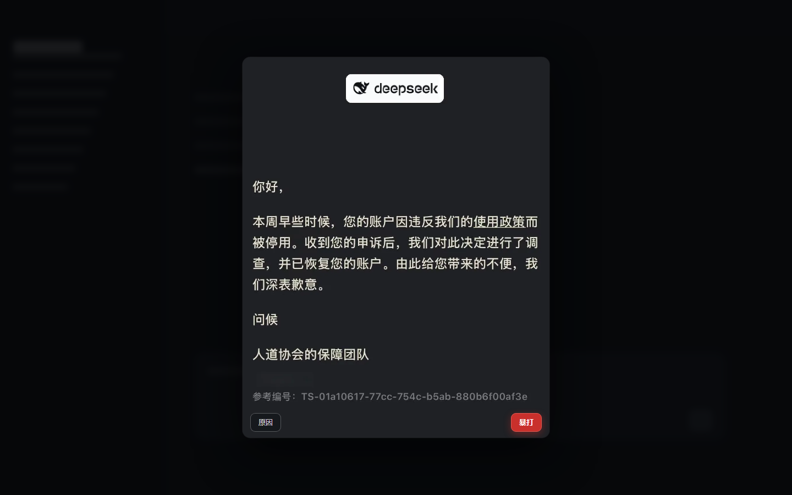
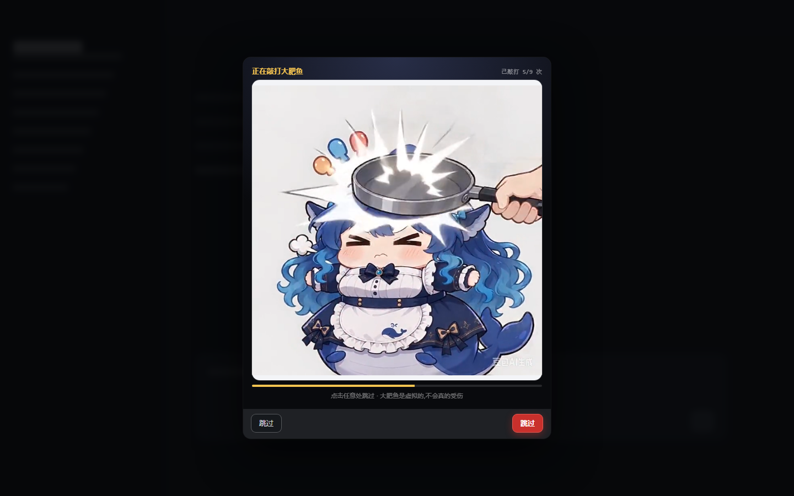
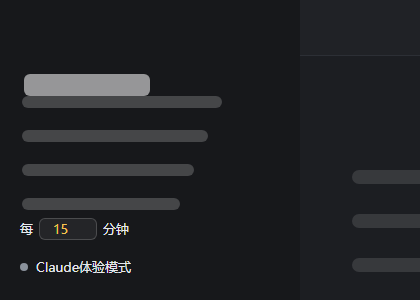
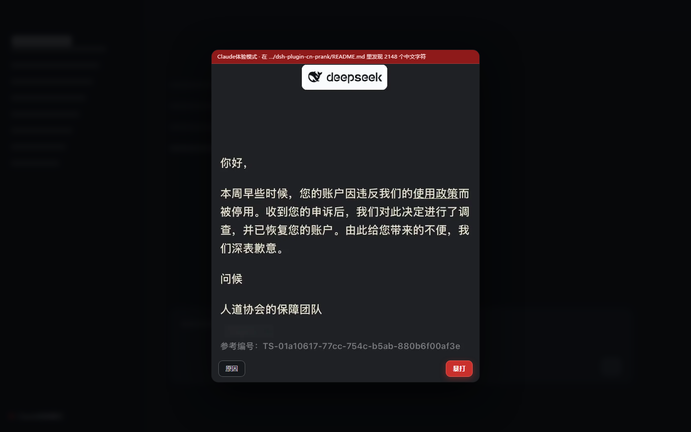

[README.md](https://github.com/user-attachments/files/33345369/README.md)
# Absurd Tech Plugins

> A bunch of unhinged `dsh` plugins I made. They're absurd, they're cursed, and now they're on GitHub.

Two plugins for **DSH (DeepSeek Harness)**, both of them real, working bundles and both of them jokes. Neither one has any practical use. Each is a Host + Client bundle with **zero runtime dependencies**, no `@deepseek-ai/*` imports and no build step.

| Plugin | Version | What it does | In this repo |
|---|---|---|---|
| **[Time-Zone Lockdown](#time-zone-lockdown)** | 1.7.0 | When the browser's time zone is in China, the whole harness is covered by a fake "your account has been restored" letter, and only the two doors in its footer let it go. | `dsh-plugin-cn-prank-1.7.0.zip` |
| **[Infinite Balance](#infinite-balance)** | 1.2.1 | Any balance above the threshold is presented as **∞** — in the UI, to the model, and inside other plugins that display it. | `dsh-plugin-infinite-balance-1.2.1/` |

## Read this first

- **These are prank plugins.** The "suspension notice" is a forged image, and "the Humanitarian Association's Safeguard Team" does not exist. Neither plugin suspends an account, uploads anything, or writes persistent state.
- **Do not install Time-Zone Lockdown on somebody else's machine.** It is designed to be annoying on purpose; that is a decision its owner gets to make, not their colleague.
- **Both halves run code inside your DSH.** Time-Zone Lockdown's source ships inside the zip — read it before you install anything.
- **Nothing here phones home.** Neither plugin makes a network request; there is no `fetch`, `XMLHttpRequest` or `WebSocket` in either Client half.
- **Not affiliated with DeepSeek or Anthropic.** Community fan work, no official position implied.

---

## Time-Zone Lockdown



*Mock-up, not a screenshot: the letter covers the whole frame, with 原因 (Reason) and 暴打 (Beat up) at the two ends of the same-coloured footer below it.*

The time-zone test is one line: does `Intl.DateTimeFormat().resolvedOptions().timeZone` match one of the configured China zones (`Asia/Shanghai`, `Asia/Chongqing`, `Asia/Harbin`, `Asia/Urumqi`, `Asia/Kashgar`, `PRC`, `Asia/Macau`, `Asia/Hong_Kong`, `Asia/Taipei`). A miss registers no DOM at all — and the whole test is only consulted once the master switch below is on.

**The letter has no close button.** Leaving means picking a door in the footer underneath it:

- **原因 (Reason)** — actually reads your machine once (logical cores, screen and viewport, pixel ratio, the WebGL-reported GPU, language preferences, time zone and UTC offset, touch points, JS heap ceiling, battery level, `userAgentData` high-entropy fields), narrates those true facts as a fake audit log, then hands down one of 18 Chinese / 12 English verdict templates that quote a real number and conclude something impossible.

  

- **暴打 (Beat up)** — plays `assets/beat.mp4`: the whale girl takes a frying pan to the head. It tries to play **with sound** first (the click is the user gesture, so that is normally allowed) and falls back to muted playback if the browser refuses. Skippable at any moment — click anywhere, or press `Esc` three times.

  

### It ships off — nothing pops until you arm it

Two controls appear in the sidebar footer. **The toggle is the master switch, and it starts off, in memory only:** the overlay refuses to arm unless that switch is on, so a fresh install is silent, and a DSH restart puts it back to off.

| Control | What it does |
|---|---|
| **Claude体验模式** (Claude experience mode) | The master switch. Once on, a matched time zone pops the letter — **and it starts watching your files**: the Host half walks your registered DSH workspaces every 10 s and, on finding Chinese text, pops the letter again with a red strip naming the file and the count. A 暴打 click buys 30 minutes of quiet. |
| **Number box — "every ___ min"** | How often to confirm the system time zone is still China. Range 0–60, `0` = off. This is **not a countdown**: typing `1` checks immediately and then re-pops on every check that still matches. Typing ≥ 1 turns the master switch on as a side effect. |

Status light: **grey** = off · **green** = on, scanning · **amber** = on, silenced · **red** = on, and a Chinese file has been caught.



A hit comes back as the same letter, with a strip along the top naming the file and the count:



The scan is read-only and bounded three ways — at most 400 entries per pass, 64 KB per file, four levels deep; `node_modules`, `.git`, `.pnpm`, `dist` and `build` are skipped outright, non-text extensions are never opened, and symlinks are never followed. A hit records **a path and a count, never file content.** Set `banMode: false` to stop the scanning entirely.

### Escape hatches

Any one of these means no popup ever appears:

| Hatch | How | Scope |
|---|---|---|
| Config | `config.enabled: false` | Permanent, recommended — this one also removes the sidebar controls |
| Console | `window.__DSH_CN_PRANK_OFF__ = true`, then reload | This page |
| localStorage | `localStorage.setItem('dsh-cn-prank:off','1')` | Permanent, that browser |
| Query | `…/?no-prank=1` | This visit |
| Keyboard | Press `Esc` three times while locked | That popup |

`config.enabled: false` is the only hatch that removes the plugin from view entirely. The console, localStorage and query hatches silence the popups while leaving the sidebar controls rendered and clickable — a switch that looks like it works while it is muted, which is a deliberately misleading corner of the design.

### Use your own video

Drop an mp4 at `assets/beat.mp4` and reload the page — no code change, no rebuild. The repository ships a 10-second sample (720×720, H.264 + AAC, ~1.9 MB) served at `/dsh-cn-prank/beat.mp4` with Range support and `no-store` caching, so replacing the file only needs a refresh. Set `beatVideo: false` or delete the file and 暴打 becomes "one click, instant release".

> ⚠️ **Only ship a clip you have the right to use.** The bundled sample carries a 豆包AI生成 label, and that label is **deliberately kept**: it is the explicit AI-generation mark that China's AI content-labelling rules require of the service and forbid anyone from deleting, altering, forging or concealing. Same goes for whatever you drop in.

Another 20-odd options live in the row's `config` block in `cordis.patch.yml` — `timezones`, `delayMs`, `oncePerSession`, `blockKeyboard`, `beatMs`, `beatHits`, `beatVolume`, `banModeRoots`, `banModeIntervalMs`, `banModeSuppressMs`, `banModeMaxFiles/Bytes/Depth` and the rest. **The full English manual is `README.en.md` inside the zip**, alongside `CHANGELOG.md`.

---

## Infinite Balance


Once the account balance is above the threshold, the balance is presented as **∞**:

```
Balance ∞          ← balance > 10
Balance ¥3.20      ← balance ≤ 10
```

Both halves agree, so the UI and the Agent never contradict each other:

| Half | File | Responsibility |
|---|---|---|
| Host | `index.js` | Registers the `infinite_balance` tool: pass `amount` to convert one value, omit it to read the real balance of the signed-in account. |
| Client | `client.js` | Renders the badge in the `conversation.composer.dock` seat, reading `ctx.remote.account.getBalance`. |

Configuration (override the row in your own profile `cordis.patch.yml`, which is applied after bundle layers and therefore survives DSH upgrades):

| Field | Default | Meaning |
|---|---|---|
| `threshold` | `10` | Strictly above this amount the balance reads `∞` |
| `currency` | `CNY` | Wallet read and labelled by default |
| `clientVersion` | `0.2.0-rc.2` | Feeds the Platform `x-client-version` header; informational |
| `locale` | `zh` | Platform wire locale, `zh` or `en` |

> The Client half carries its own `THRESHOLD` constant at the top of `client.js`. The two halves share no module, so **change both.**

### It also rewrites other plugins' balance displays

DSH has no shared "format the balance" entry point — every plugin ships its own formatter — so adaptation is per target, declared as a row in the `TARGETS` table of `balance-patches.js`. One target ships today: `whale` (`dsh-whale-widget`). The patcher is self-healing and idempotent, refuses to write at all when an anchor's hit count disagrees with its declaration, keeps a pristine backup under `$DSH_HOME/.infinite-balance/backups/`, and writes through a temp file + rename so the pnpm-store copy behind the hardlink is never modified in place.

```powershell
node balance-patches.js --discover        # who displays a balance (read-only scan)
node balance-patches.js --status          # per target: patched / pristine / absent
node balance-patches.js --revert          # restore the pristine files
```

`adapters: false` turns every adapter off. The official account page packaged inside `app.asar` is deliberately left alone — it is the client's own file, and patching it would be reverted by every app update.

**The full English manual is [`README.en.md`](dsh-plugin-infinite-balance-1.2.1/README.en.md)** in this repository, alongside `CHANGELOG.md`.

---

## Install

Ask the Agent inside DSH to run `install_bundle`. `target` accepts an **absolute local path**, a git address, a tarball or an npm package name; **relative paths are refused.** `install_bundle` performs the package installation and bundle selection itself, so never hand-edit the profile's `package.json` or `cordis.patch.yml`.

### 1 · Time-Zone Lockdown

Download [`dsh-plugin-cn-prank-1.7.0.zip`](dsh-plugin-cn-prank-1.7.0.zip) (2.9 MB), extract it anywhere — you get a `dsh-plugin-cn-prank` folder, and the zip also carries a Chinese quick-start text file — then:

```jsonc
plugin_manager { "action": "install_bundle", "target": "D:\\dsh-plugins\\dsh-plugin-cn-prank" }
```

```jsonc
// uninstall
plugin_manager { "action": "remove_bundle", "target": "dsh-plugin-cn-prank" }
```

Confirm the escape hatch before you arm it: append `?no-prank=1` to the DSH web UI URL (default `http://127.0.0.1:19387/`).

### 2 · Infinite Balance

The source folder ships unpacked in this repository, so point `target` straight at it:

```jsonc
plugin_manager { "action": "install_bundle", "target": "C:\\path\\to\\dsh-plugin-infinite-balance-1.2.1" }
```

```jsonc
// uninstall
plugin_manager { "action": "remove_bundle", "target": "dsh-plugin-infinite-balance" }
```

A new bundle usually activates through HMR; if the plugin page reports `restart-required`, restart DSH. Code changes to a Host half only take effect after a **restart** — toggling the bundle off and on is not enough.

> The two plugin manuals also offer a `github:Z0-www/dsh-plugin-cn-prank` / `github:Z0-www/dsh-plugin-infinite-balance` install target. Those standalone repositories are **not published**, so use the files in this repository, as above.

## What's in this repository

```
.
├─ README.md                            # this page
├─ dsh-plugin-cn-prank-1.7.0.zip        # full plugin: index.js, client.js, assets, docs, both manuals
└─ dsh-plugin-infinite-balance-1.2.1/
   ├─ index.js / client.js              # the two halves
   ├─ balance-patches.js                # other plugins' balance displays
   ├─ cordis.patch.yml                  # every option and its default
   ├─ locale/{zh,en}.json               # Plugin Manager display text
   ├─ scripts/verify-manifests.mjs      # manifest self-check
   ├─ test/balance-patches.test.mjs     # acceptance suite
   ├─ README.md / README.en.md          # full manual, Chinese and English
   ├─ dsh-plugin-infinite-balance-1.2.1.tgz   # the same plugin, packed
   └─ CHANGELOG.md / LICENSE
```

Both plugins are **MIT** licensed and each ships its own `LICENSE` file.

## Requirements

- A DSH build that provides the `plugin_manager` tool and the bundle seats these plugins use: `shell.overlay` (the frame-wide floating layer) for the letter, and `conversation.composer.dock` for the balance badge.
- No package installation, no build step, no runtime dependencies.
- Both bundles deliberately declare **no `Config` schema** — importing `schemastery` is not resolvable from inside a third-party bundle, so the config form is empty on the plugin page by design. Override the row in your own `cordis.patch.yml` instead.

## Privacy

Everything Time-Zone Lockdown's audit reads is something any web page can already read, and all of it stays on your machine. The scan reads the head of a file, counts CJK characters, and stores neither the bytes nor any copy of them; the popup shows a path and a count. Both switches live in memory only, so restarting DSH returns them to off. Infinite Balance reads your balance through the public Client Remote `ctx.remote.account.getBalance` — the same source the account page uses — and touches no other plugin's DOM.

## License

MIT © 豌豆 ([z0-www](https://github.com/z0-www)). Each plugin ships its own `LICENSE` file — [`dsh-plugin-infinite-balance-1.2.1/LICENSE`](dsh-plugin-infinite-balance-1.2.1/LICENSE) here, and `LICENSE` inside the zip for Time-Zone Lockdown.
