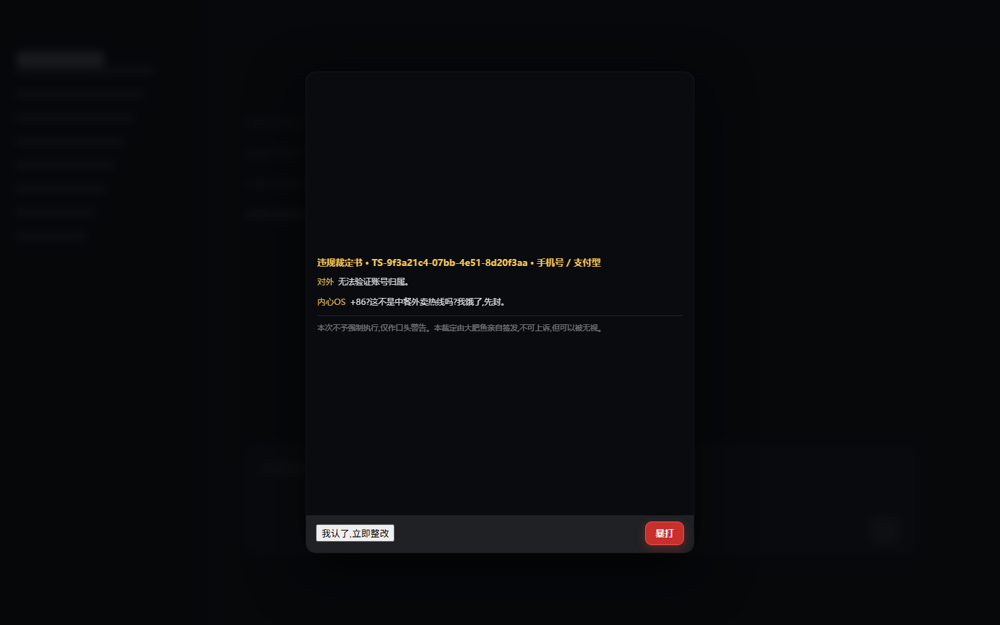

# Time-Zone Lockdown

English | [中文](README.md)

> A DSH gag bundle with **no practical use**: when the browser's time zone is inside China, the whole harness is covered by a fake "your account has been restored" letter, and only the two doors in its footer let it go.

A Host + Client DSH bundle. Zero runtime dependencies, no `@deepseek-ai/*` imports, no build step.


*Mock-up, not a screenshot: the letter covers the whole frame, with "原因" and "暴打" at the two ends of the same-coloured **footer below it**.*



*Mock-up: after "原因", the fake audit narrates real device facts and then hands down an obviously impossible charge.*

> **This is a prank plugin, not a real suspension notice.** The image is a forged screenshot, "the Humanitarian Association's Safeguard Team" does not exist, and the plugin never suspends an account, uploads anything, or writes persistent state. Both buttons release, and there are five escape hatches below. **Do not install this on somebody else's machine.**

## What it does

| Half | File | Job |
|---|---|---|
| Host | `index.js` | Holds the Loader row (no row, no `dsh.client`) and publishes the row's `config` to the browser as a structured `webserver/index-inject` `global` row. |
| Client | `client.js` | Reads the time zone, decides, and renders a full-frame letter into the `shell.overlay` seat; blocks the keyboard; runs a fake audit; hands down a verdict. |

The gate is one line: does `Intl.DateTimeFormat().resolvedOptions().timeZone` match a configured zone. A miss registers no DOM at all.

## Install

```jsonc
plugin_manager { "action": "install_bundle", "target": "github:Z0-www/dsh-plugin-cn-prank" }
```

Uninstall:

```jsonc
plugin_manager { "action": "remove_bundle", "target": "dsh-plugin-cn-prank" }
```

The letter appears on the next page load. To confirm the escape hatch first:

```
http://127.0.0.1:19387/?no-prank=1
```

## The two buttons

Both live in a footer **below** the letter, one on each side — the letter has no close button, so leaving means picking a door.

> Why not on the letter's corners: the last line of the image ("参考编号: TS-…") sits 26px above its bottom edge — about 14px once the card is 560px wide — so any button overlaps it. The footer's background is sampled from the image itself (`#1f2125`), which makes it read as extra letter rather than as a stuck-on button bar. Swap `notice.webp` and that colour has to move with it (`NOTICE_BG` in `client.js`).

**Bottom-left "原因" (Reason)** — really reads the local machine once (logical cores, screen and viewport, pixel ratio, the WebGL-reported GPU, language preferences, time zone and UTC offset, touch points, JS heap ceiling, battery level and charging state, `userAgentData` high-entropy fields), narrates those true facts as a fake audit log, then hands down one of 18 Chinese (12 English) verdict templates that quote a real number and conclude something impossible:

> **Charge** Hoarding logical cores
> **Evidence** This machine owns 16 logical cores. Two are thinking about dinner unattended and one is suspected of a cross-time-zone quantum slacking experiment.
> **Penalty** Confiscation of half a core, suspended until the next reboot.

**Bottom-right "暴打" (Beat up)** — plays `assets/beat.mp4`: the whale girl takes a frying pan to the head and ends up face-down in a pile of stars.


*Real browser render: the clip sits in a light frame, because it comes with its own light background and would otherwise be a glaring white square on a dark stage.*

- **It makes a sound.** `assets/beat.mp4` carries its own AAC track — it was silent only because the plugin muted it (browsers refuse unmuted autoplay, and muting is the lazy fix). It now **tries with sound first**: clicking 暴打 is itself the user gesture, so that is normally allowed; a refusal falls back to muted playback and says so at the foot of the stage, so the picture never stops because the sound was blocked. See [Sound](#beat-sound).

- **The clip wins, and it is now the only thing there is.** The repository ships a 10-second sample; drop your own in to replace it — see [the next section](#beat-video). **The vector animation was removed in 1.7.0**: with no playable clip (file deleted, `beatVideo: false`, or the route never registered) 暴打 releases immediately instead of performing a second animation.

- **The counter and the progress bar.** "已敲打 N/9 次" on the right of the header, and the bar at the foot of the stage, are driven by `beatHits` and `beatMs`: one hit every `beatMs / beatHits` (at least 90 ms). The clip **loops**, so `beatMs` is also how much of it you see — 3200 ms by default, roughly the first third of that 10-second sample.

- **Skippable at any moment** — click anywhere on the screen, or press Escape three times.
- DSH comes back exactly as it was; no reload.

Set `beatMs: 0` to drop the whole segment and go back to "one click, instant release".

<a id="beat-video"></a>
## Use your own video

Drop an mp4 at `assets/beat.mp4` and you are done — no code change, no rebuild. The repository ships one as a working example; overwrite it.

```powershell
# overwrite the sample, reload the page, click 暴打
copy my-clip.mp4 assets\beat.mp4
```

**Why it is not inlined like the letter.** The two assets trade in opposite directions. The Client bundle declares `immediately: true` (the lockdown has to beat the composer to the screen), so base64'ing a 2 MB clip into it would mean **every page load downloads 2.5 MB** — and most visits never click 暴打 at all. The clip therefore lives behind one Host route and is fetched only at the moment somebody actually clicks.

| Fact | Value |
|---|---|
| Route | `/dsh-cn-prank/beat.mp4`, registered by `index.js` |
| Range support | Yes (`Accept-Ranges: bytes`, `206 Partial Content`) — without it Chromium downloads the whole file before seeking, so the first frame freezes |
| Caching | `no-store`, so **replacing the file only needs a page reload** |
| CORS | `Access-Control-Allow-Origin: *`, because the page may be `dsh-app://` rather than same-origin |
| The shipped sample | 720×720 / 10.08 s / H.264 + AAC / about 1.9 MB |
| Suggested shape | mp4 / H.264, square-ish, ≤10 s, a few MB |
| Turning it off | `beatVideo: false`, or just delete the file — either way 暴打 becomes "one click, instant release" |

> ⚠️ **Only ship a clip you have the right to use.** The sample in this repository carries a 豆包AI生成 label, and that label is **deliberately kept**: it is the explicit AI-generation mark that China's AI content-labelling rules require of the service and forbid anyone from deleting, altering, forging, or concealing. The same goes for whatever you drop in — if it carries a label, **leave it on**.

**Code changes need a restart.** `assets/beat.mp4` is read per request, so swapping the file only needs a page reload; but after editing Host code such as `index.js`, DSH only reloads that module on a **restart** — toggling the bundle off and on is not enough (measured: `apply()` is not re-run).

<a id="ban-mode"></a>
## Claude experience mode (Claude体验模式)

The time-zone gate fires on its own. Claude experience mode is the one **you** switch on — and then it starts watching your files.

> **Only the name changed; the config keys did not.** This feature used to be called "ban mode" and is labelled **Claude体验模式** in the UI from 1.6.1. But `banMode`, `banModeRoots`, `banModeIntervalMs`, `banModeSuppressMs` and `banModeMaxFiles/Bytes/Depth` **keep their original names on purpose** — they are the public override surface, and renaming them would silently void every profile override already written. The `/dsh-cn-prank/status` route is in the same boat.


A toggle appears in the sidebar footer, and its status light is the whole state:

| Light | Meaning |
|---|---|
| Grey | Off |
| Green | On, scanning |
| Amber | On, silenced (the 30 minutes) |
| Red | On, and it has already caught a Chinese file |

> The number box's light in the same picture is a **separate** one: grey = no re-check interval set, amber = re-checking every N minutes. Each light describes its own control.

With it on, the Host half walks your **registered DSH workspaces** every `banModeIntervalMs` (10 s by default). The moment it finds Chinese inside a file, the full-frame letter comes back — with a strip along the top naming the file and the count:


- **A 暴打 click buys 30 minutes of quiet** (`banModeSuppressMs`). Scanning keeps running through the silence, but a hit found inside it is thrown away — so the popup comes back on its own once the window closes, rather than needing the toggle again.
- **The 原因 path silences it too.** The only difference is whether you read the verdict on the way out.
- **What it looks at:** the workspace directories you registered with DSH, **not your home directory**. Point it somewhere explicit with `banModeRoots: ['D:\some\dir']`.
- **Bounds:** at most 400 files per pass, 64 KB per file, four levels deep; `node_modules`, `.git`, `.pnpm`, `dist`, `build` and friends are skipped outright; non-text extensions are never even opened; symlinks are never followed.
- **Read-only, and it never leaves the machine:** it reads the head of a file, counts CJK characters, and stores neither the bytes nor any copy of them. The popup shows a **path and a count**, never file content.
- **To stop it scanning:** `banMode: false` turns the **scan** off. The toggle and the status route stay (that toggle is the whole plugin's master switch), the `scans` field in the status document goes false, and the light turns dim grey reading "cannot scan" — but the disk is never read and a hit can never happen again.

> It ships **off**, and its state lives in memory only — a DSH restart puts it back to off. That is the right temperament for a prank switch.

<a id="zone-recheck"></a>
## Time-zone re-check interval

A second control sits in the sidebar footer: a plain **number box** you type into, wrapped in "every ___ min". Range 0–60, where 0 = off.

> ### This is not a countdown
>
> It asks "**how often should I confirm the system time zone is still China**", not "how long until it pops". Those sound alike and behave nothing alike:
>
> - Typing 1 does **not** mean "pops in one minute". It means **check right now** (and pop immediately if the zone matches), then check again every minute, popping **again** on every check that still matches.
> - It is the **only** suspension popup that no scan result triggers: no Chinese file is needed. Sitting alone in an empty directory still gets you one.
> - It is also the **only** popup that a file cannot cause and a zone can: if the browser's zone is not in `timezones`, it never fires. It shares that judgement with the time-zone gate.
>
> Why not a countdown: on that road "the clock ran out" and "the zone still matches" are two separate facts, and the charge the letter names (the "using a proxy / VPN violates the terms of service" family) only stands on the second one. This version picked the second.

| Action | Result |
|---|---|
| Type in the box (0–60) | Commits once, 600 ms after you stop typing; typing "12" passes through a "1", and without that debounce it would be two requests. Enter means "done" and commits at once |
| Type 0, or clear it | Cancels the re-check. **The master switch stays on** |
| Type ≥1 | **Turns the master switch on as a side effect** — a control that accepts input and then does nothing, with the reason hidden behind a different button, is the worst possible design |
| Turn the master switch off | Clears the interval too — "off means nothing pops" must not be bypassed by an interval that was already scheduled |
| Reload the page | The interval survives: the host holds the number, and the overlay re-arms from it on every load |
| Restart DSH | Back to "off". State lives in memory only, like the 30-minute silence |

An empty box shows a grey "off" — the same thing as typing 0, because it is the same thing.

The letter this path pops carries **no strip along the top**. That strip exists for one reason — to name the file and the count — and this path has neither, so the joke line it used to print there was removed in 1.6.1. **The cost:** this letter is now indistinguishable from the time-zone one; nothing on screen says which path called it.

Once it is set the light is **amber** and the tooltip reads "the system time zone is re-checked every N min"; grey means it is not set.

## Configuration

Edit the `config` block of the row in `cordis.patch.yml`, or override it from your own profile patch (applied after bundle layers, so it survives DSH upgrades):

| Field | Default | Meaning |
|---|---|---|
| `enabled` | `true` | Master switch; `false` = the bundle does nothing |
| `timezones` | 9 China zones | `Asia/Shanghai`, `Asia/Chongqing`, `Asia/Harbin`, `Asia/Urumqi`, `Asia/Kashgar`, `PRC`, `Asia/Macau`, `Asia/Hong_Kong`, `Asia/Taipei` |
| `delayMs` | `900` | Delay before the letter shows, so the frame paints first |
| `oncePerSession` | `true` | `true` = once per browser session; `false` = every page load |
| `blockKeyboard` | `true` | Swallow every keyboard event while locked (`Ctrl+K`, `Esc`); the mouse is untouched |
| `scanMs` | `4200` | Upper bound of the fake audit |
| `reasonAutoCloseMs` | `0` | Auto-release after the verdict; `0` = the human must click |
| `beatMs` | `3200` | Length of the 暴打 segment, and the playback cap for the clip (which loops); `0` = release immediately |
| `beatHits` | `9` | How many hits the progress bar and the "已敲打 N 次" counter count (1-999). **Each hit takes at least 90 ms**, so a large hit count runs longer than `beatMs` |
| `beatVideo` | `true` | `true` = play the `assets/beat.mp4` shipped in this package; `false` = no clip, 暴打 releases immediately |
| `beatVolume` | `0.9` | Volume of the clip's own track (0–1) |
| `beatMuted` | `false` | `true` = always play the clip muted |
| `beatSfxOverVideo` | `false` | Layer the synthesised hit effects over your clip (wanted when your clip is silent) |
| `beatSfxVolume` | `0.5` | Volume of the synthesised effects (0–1) |
| `banMode` | `true` | Whether Claude体验模式 is allowed to **scan**. `false` = the master switch only covers the time-zone letter and the disk is never read (the toggle and the route stay; the light goes dim grey, "cannot scan") |
| `banModeRoots` | `[]` | Directories to scan; empty = the registered DSH workspaces. With no workspace registry it scans **nothing** rather than falling back to the Host process's current directory |
| `banModeIntervalMs` | `10000` | How often to scan; anything below 1000 is raised to 1000 |
| `banModeSuppressMs` | `1800000` | Milliseconds of quiet a 暴打 click buys (30 minutes) |
| `banModeMaxFiles` | `400` | **Entries** one pass may examine — files and directories together; `0` = it can never hit |
| `banModeMaxBytes` | `65536` | Bytes one file may contribute — a bigger file is read **up to that many bytes**, not skipped |
| `banModeMaxDepth` | `4` | How deep one pass may go |

```yaml
- id: cn-prank
  name: dsh-plugin-cn-prank
  config:
    timezones:
      - Asia/Shanghai
    delayMs: 3000
    reasonAutoCloseMs: 8000
```

> The bundle deliberately declares no `Config` schema: doing so would require importing `schemastery`, which a third-party bundle cannot resolve inside a profile. Override the row instead.

<a id="beat-sound"></a>
### Sound

暴打 has two possible sources, and they are switched separately:

| Source | When it plays | Default |
|---|---|---|
| The clip's own audio track | while the clip plays | **on** (`beatVolume: 0.9`) |
| Synthesised hit effects | layered over the clip | **off** (`beatSfxOverVideo: false`) |

**Why the clip gets no effects by default:** it already has a track, and stacking thuds on top only muddies it. So layering over a clip is opt-in: if your clip is **silent**, that is the switch you want (and drop `beatHits` while you are there, or you will hear nine hits in three seconds).

> **Since 1.7.0 that is the synth's only job.** `beatSfx` (the hit effects for the vector fallback, on by default) was removed along with the vector animation — where there is no vector animation, there is no "no sound source" problem to solve.

The effects **ship no audio files**: one "frying pan meets plush toy" is a short band-passed noise burst (the *smack*) plus a fast downward sine sweep (the *thump*), each with its own envelope. No sampled assets to add hundreds of KB, and nothing to guess about codec support.

An `AudioContext` has to be created inside a user gesture, or the browser leaves it `suspended` and swallows the first sound — so the graph is built on the **暴打 click**, not at page load.

## Escape hatches

Any one of these means **no popup ever appears**:

| Hatch | How | Scope |
|---|---|---|
| Config | `config.enabled: false` | Permanent, recommended. This one also removes the sidebar controls |
| Global | `window.__DSH_CN_PRANK_OFF__ = true` in the console, then reload | This page |
| localStorage | `localStorage.setItem('dsh-cn-prank:off','1')` | Permanent (that browser) |
| Query | `…/?no-prank=1` | This visit |

> **The last three silence popups, not the sidebar.** With a hatch open, the toggle and the number box still render, still click, still fill; the light still changes colour; the scan still runs — nothing ever pops. That is a deliberate trade (removing the controls would turn "why did nothing pop?" into "why did the button disappear?"), but it is also a genuinely misleading corner: a switch that looks like it works while it is muted. For "make it disappear entirely", use `config.enabled: false`.

### The fifth: press Escape three times

While locked, **pressing Escape three times in a row** also releases. It counts three `keydown`s — a held key's auto-repeat does not count, and that third press is swallowed too rather than handed to the app. It is unnecessary when `blockKeyboard: false`.

Three is deliberate: one press could be a slip, three cannot be. A prank is allowed to be annoying; it is not allowed to actually trap someone — least of all a user whose only way to say "the buttons do not work" is the very interface that is covered.

## Privacy

Everything the audit reads is something any web page can already read, and all of it stays local: time zone and UTC offset, hardware concurrency and device memory, screen and viewport, the unmasked WebGL renderer string, `userAgentData` high-entropy values (Chromium only), language preferences, touch points, the JS heap ceiling, and battery level (Chromium only). The values are used to draw a few lines of theatre and one absurd accusation, then dropped. **There is no `fetch`, `XMLHttpRequest`, or `WebSocket` anywhere in `client.js`.**

## Swapping the letter

The artwork is `assets/notice.webp` and is inlined into `client.js` as a data URI — a Client half reaches the browser as a single file, so a sibling asset would depend on the Host half having registered its route first and on the page origin matching. A data URI has neither failure mode. That makes one block of `client.js` generated:

```powershell
npm run notice                                          # re-inline assets/notice.webp
node scripts/build-notice.mjs --source my-new-image.png # or start from another file
npm run verify                                          # what CI checks
```

`scripts/build-notice.mjs` rewrites only the line between `/* @notice-image:begin */` and `/* @notice-image:end */`.

## Layout

```
.
├─ package.json              # dsh.bundle.patch + dsh.client, icon, exports, files
├─ cordis.patch.yml          # inserts the loader row (id: cn-prank) and every option
├─ index.js                  # Host: the row, publishing config, beat clip, ban scanner
├─ client.js                 # Client: gate, lockdown layer, audit, verdict, beat, ban toggle
├─ assets/notice.webp        # the letter (source of truth, 55 KB)
├─ assets/beat.mp4           # the 暴打 clip (a 1.9 MB sample ships; overwrite it)
├─ docs/preview-*.png        # the five README mock-ups
├─ icon.svg
├─ locale/{zh,en}.json       # Plugin Manager display text; en.json must exist
├─ scripts/{build-notice,verify-manifests,make-previews,test-host-route,test-ban-mode}.mjs
├─ scripts/preview/harness.html
├─ .github/workflows/ci.yml
└─ README.md / README.en.md / CHANGELOG.md / LICENSE
```

## Compatibility and failure posture

- **Seat** — `shell.overlay` is the frame-wide floating layer, and it is click-through by design: an occupant has to take pointer events back itself. The overlay root sets `pointerEvents: 'auto'`, without which it would neither cover nor click.
- **Stacking** — `z-index: 9000`, above the official onboarding overlay's `900`.
- **Size** — the card's width is `min(92vw, 560px, 62vh)`, so the letter plus its footer stays fully visible at any window shape and the doors never drift off it.
- **Doors in a footer, not floating** — the two buttons are ordinary flow children of the card; the panels (audit, verdict, beat stage) are absolutely positioned inside the image's frame only, so a panel can never cover an exit.
- **Claude experience mode's bounds** — the scan is read-only, explicitly switched on, capped three ways (**entries** — files and directories together — bytes, and depth, so a tree of nothing but directories cannot make one pass run forever), and defaults to the registered DSH workspaces; non-text extensions are never opened and symlinks are never followed. A hit records a path and a count, never content. With `banMode: false` the scanning stops, but the toggle and the status route stay — that toggle is the plugin's master switch.
- **Two pop-up paths never interrupt work in progress** — a scan hit or a re-check tick only raises the letter while `phase` is `idle`/`over`. Without that gate, the fresh `hit.at` the Host stamps every 10 seconds would replace a verdict you were halfway through reading, and stop the beating animation mid-swing.
- **One store, two consumers** — the sidebar toggle and the overlay share a single ref-counted poll, because two independent pollers would let "the button says silenced" and "the overlay decides to pop" disagree, which reads as a popup that comes back after you close it.
- **The re-check interval's clock is client-side** — the host holds one number, which is why a page reload keeps the interval, while the `setInterval` and the zone check run in the browser. Two open pages mean two re-checks, each popping its own letter, and neither writes any state.
- **Keyboard** — `keydown`/`keyup`/`keypress` are swallowed on `window` in the **capture** phase with `stopImmediatePropagation`, so every shipped shortcut is dead while locked. The mouse keeps working; both buttons stay clickable.
- **TDZ** — `NOTICE_IMAGE` is declared *before* `window.__ModuleLoader__.load(...)`, because the factory may be invoked synchronously and a trailing `const` would leave the whole Client half in a temporal dead zone.
- **Config channel** — the structured `webserver/index-inject` `global` row. The Desktop shell renders its own `index.html` where `tapIndex` never runs, so the structured row is the one channel both compositions read.
- **Optional services** — the language comes from `ctx.get('locale')`, falling back to `navigator.language`; the Host half depends on nothing but the injection row and logs one warning when a composition has no web server.
- **Failure posture** — an unreadable time zone, a missing `getBattery`, a disabled WebGL context, or blocked storage all degrade to one missing log line or the default settings. No slot crashes, and nothing that matters is ever actually held back — only `Ctrl+K` is.
- **No residue** — every registration lives in `ctx.effect` and returns its disposer, so uninstalling takes the DOM and the listeners with it.

## License

[MIT](LICENSE)
